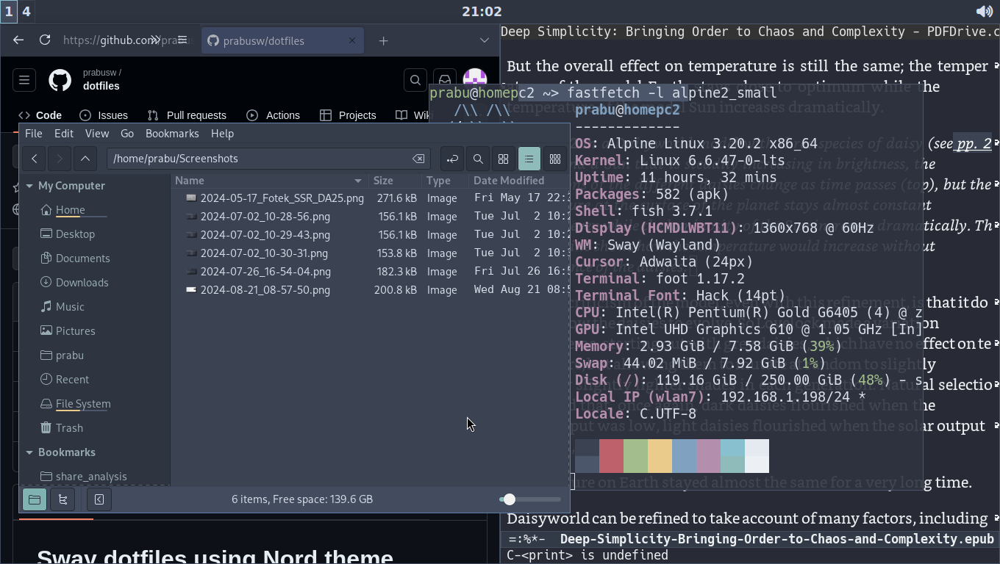

# Dotfiles for running SwayWM on Alpine Linux

Dotfiles related to running SwayWM on Alpine Linux along with all the
related tools listed below can be found in this repository.



## OS level
* Filesystem - [btrfs](https://docs.kernel.org/filesystems/btrfs.html)
* Boot manager - [refind](https://www.rodsbooks.com/refind/)
* Backup tool - [btrbk](https://digint.ch/btrbk/)
* Automatic snapshot - a custom vibe coded script snapk for use with apk
* Using openRC user services at 'gui' runlevel for the following services with :
** Break reminder to avoid eye strain- [swayeyes](https://git.sr.ht/~prabuanand/swayeyes)
** Audio stack - [Pipewire](https://pipewire.org/)
** Day/night gamma adjustments for Wayland - [wlsunset](https://git.sr.ht/~kennylevinsen/wlsunset)
* Wayland stack
** For runtime directory (XDG_RUNTIME_DIR) [pam-rundir](https://jjacky.com/pam_rundir/)
** Seat manager - [seatd](https://sr.ht/~kennylevinsen/seatd/)
** Login manager - [greetd](https://sr.ht/~kennylevinsen/greetd/) with [gtkgreet](https://git.sr.ht/~kennylevinsen/gtkgreet) greeter.
* privilege escalation - [doas](https://github.com/Duncaen/OpenDoas)

## Sway configuration

SwayWM has been configured using the following tools:
* Terminal - [foot](https://codeberg.org/dnkl/foot)
* Notification daemon - [mako](https://github.com/emersion/mako)
* Locking tool - [swaylockd](https://github.com/jirutka/swaylockd)
* Feed generator for swaybar - [i3blocks](https://vivien.github.io/i3blocks/) with custom [scripts](home/prabu/.config/sway/scripts/i3blocks)
* Display time on swaybar - i3blocks uses [wayclock](home/prabu/.config/sway/scripts/i3blocks/wayclock), a custom vibe coded script in C
* Launcher menu - [tofi](https://github.com/philj56/tofi)
* Logout menu - [tofi-exit](home/prabu/.config/sway/scripts/tofi-exit) - a custom script based on [tofi](https://github.com/philj56/tofi)
* power management tool - [powerctl](https://sr.ht/~sircmpwn/powerctl/)

To achieve consistent nord theme:
* Gtk theme - [nordic](https://github.com/EliverLara/Nordic)
* Icon theme - [nordzy](https://github.com/MolassesLover/Nordzy-icon)
* Firefox - Uses custom userChrome.css based on [KeyFox](https://github.com/alfaaarex/keyfox)
* Theme switching - [toggle_theme](home/prabu/.config/sway/scripts/toggle_theme) - a custom script is used to toggle dark/light mode


## Other tools used
* File manager(s) - [nemo](https://github.com/linuxmint/nemo),[nnn](https://github.com/jarun/nnn)
* Editor - [emacs](https://www.gnu.org/software/emacs/)
* Shell - [fish](https://fishshell.com/)
* epub reader - [foliate](https://johnfactotum.github.io/foliate/)
* pdf reader - [evince](https://wiki.gnome.org/Apps/Evince)
* screenshot tool - [slurpshot](https://github.com/de-arl/slurpshot)

## Tracking dotfiles using a bare git repository

The only tool used here is git. Normal user account is used for adding
files as long as the user has 'read' permission. Only for deleting
files added from system folders and when the default user does not
have 'read' permission, sudo/doas needs to be used with full command.

The below steps will suffice to keep track of dotfiles for single
desktop. For detailed explanation refer to the sources

```
$ git init --bare $HOME/.systemfiles
$ alias sysconfig='git --git-dir=$HOME/.systemfiles --work-tree=/'
$ echo "alias sysconfig='git --git-dir=/home/prabu/.systemfiles --work-tree=/'" >> ~/.config/fish/config.fish
$ echo "alias sysconfig='git --git-dir=/home/prabu/.systemfiles --work-tree=/'" >> ~/.config/ash/ashrc
$ source ~/.config/fish/config.fish
$ sysconfig add /etc/btrbk/btrbk.conf
$ sysconfig add ../../README.md
$ cd / && git --git-dir=/home/prabu/.systemfiles --work-tree=/ ls-files
$ doas git --git-dir=/home/prabu/.systemfiles --work-tree=/ rm /usr/local/bin/current_song.sh
$ sysconfig status
$ sysconfig commit -m "added Readme.md"
$ sysconfig push origin master
```

Some dotfiles may still have references to Arch Linux. They have not
been used since Jan'25.

Besides the below, other sources are cited in individual files.

Sources:

* https://news.ycombinator.com/item?id=11071754
* https://www.atlassian.com/git/tutorials/dotfiles
